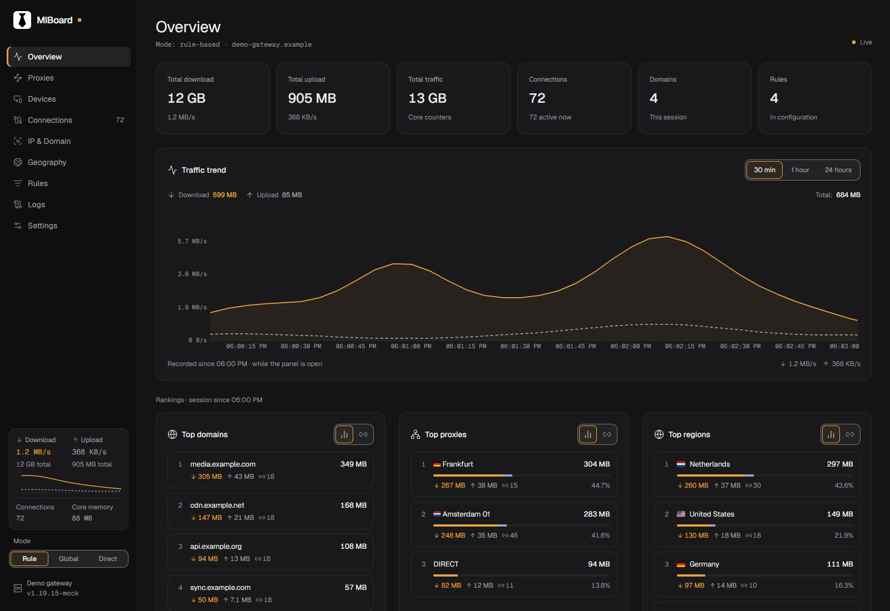
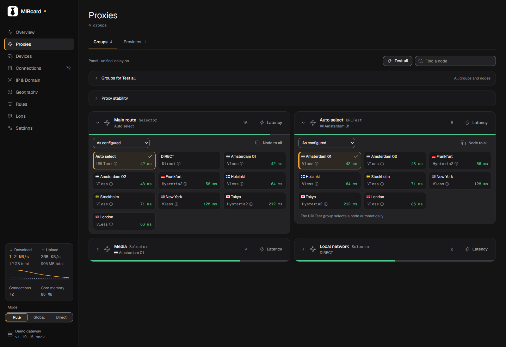
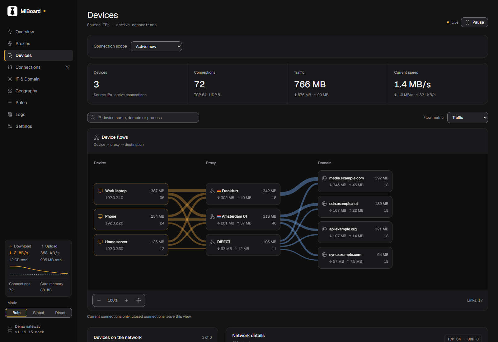
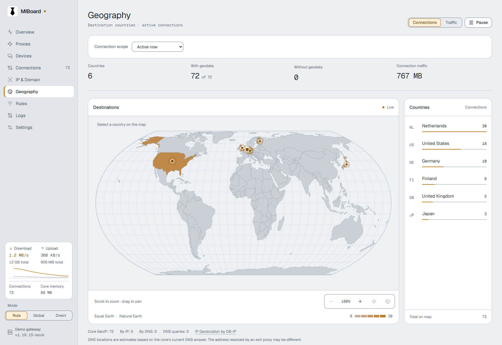

<p align="center">
  
</p>
<h1 align="center">MIBoard</h1>
<p align="center">
  <strong>Your mihomo traffic, devices and routes in one dashboard.</strong><br>
  Live metrics · Connection diagnostics · Proxy management
</p>
<p align="center">
  <a href="README.md">Русский</a> · <strong>English</strong>
</p>
<p align="center">
  <a href="https://github.com/blagodaren/miboard/releases/tag/v0.1.3"></a>
  <a href="LICENSE"></a>
  <a href="https://svelte.dev"></a>
  <a href="README.md"></a>
</p>
<p align="center">
  <a href="https://blagodaren.github.io/miboard/">Open dashboard</a> ·
  <a href="#connect-to-mihomo">Install</a> ·
  <a href="CHANGELOG.md">What's new</a> ·
  <a href="https://github.com/blagodaren/miboard/issues">Report an issue</a>
</p>

MIBoard is a static dashboard for an existing **mihomo** core. Serve it directly from the core's `/ui/` or host it separately. It needs no application server or database of its own.

> [!CAUTION]
> MIBoard controls your own mihomo instance. It does not provide a VPN, proxy servers, subscriptions or network access.
>
> The core API can change routing and configuration. Set a strong `secret`, restrict the controller to a trusted network and never share URLs containing credentials. Use HTTPS and controlled access for remote connections.

<p align="center">
  <a href="docs/images/overview-en-dark.png"></a>
</p>

<p align="center"><sub>Screenshots use demo data</sub></p>

## Features

| Area | What you can inspect and control |
| --- | --- |
| **Overview** | Download and upload, 30-minute / 1-hour / 24-hour trends, top domains, proxies and regions |
| **Proxies** | Node selection, providers and subscriptions, latency checks, per-URL histories and stability checks |
| **Devices** | Device → proxy → destination flows, local names, processes and destinations |
| **Connections** | Configurable columns, detailed metadata and JSON, a journal of closed connections |
| **IP & domains** | Traffic by domain, IP, application, ASN and inbound; DNS diagnostics and domain TXT export |
| **Geography & rules** | A local country map, traffic distribution, routing chains and rule providers |
| **Settings** | RU / EN, light and dark themes, card sizes, server profiles, settings transfer and sync |
| **Application** | PWA installation, an offline shell, update checks, stream recovery and an economy mode |

> [!NOTE]
> History covers only what an open dashboard observes. Installing the PWA does not add a background collector: disconnections and economy mode can leave gaps. The shell can open offline; live data and core commands still need API access.

[Read the feature guide and data limitations →](docs/FEATURES.en.md)

## Screenshots

<table>
  <tr>
    <td width="50%" align="center"><strong>Proxies and groups</strong></td>
    <td width="50%" align="center"><strong>Devices and flows</strong></td>
  </tr>
  <tr>
    <td><a href="docs/images/proxies-en-dark.png"></a></td>
    <td><a href="docs/images/devices-en-dark.png"></a></td>
  </tr>
</table>

<details>
  <summary>Geography — light theme</summary>
  <p><a href="docs/images/geography-en-light.png"></a></p>
</details>

## Download

| Version 0.1.3 | Choose this when | Verify |
| --- | --- | --- |
| [**dist.zip**](https://github.com/blagodaren/miboard/releases/download/v0.1.3/dist.zip) | Recommended: fonts and GeoDB are included, with no font CDN required | [SHA-256](https://github.com/blagodaren/miboard/releases/download/v0.1.3/dist.zip.sha256) |
| [dist-cdn-fonts.zip](https://github.com/blagodaren/miboard/releases/download/v0.1.3/dist-cdn-fonts.zip) | A smaller archive that loads fonts from `unpkg.com` | [SHA-256](https://github.com/blagodaren/miboard/releases/download/v0.1.3/dist-cdn-fonts.zip.sha256) |

Both archives have the same functionality. If the CDN is unavailable, the second build falls back to system fonts; color flags may be unavailable on Windows.

## Connect to mihomo

**1. Add the dashboard to your core configuration.** This example allows access from the same computer:

```yaml
external-controller: 127.0.0.1:9090
secret: "replace-with-a-long-random-secret"
external-ui: ui
external-ui-name: miboard
external-ui-url: "https://github.com/blagodaren/miboard/releases/download/v0.1.3/dist.zip"
```

For a core running on a router, use its trusted LAN interface address instead of `127.0.0.1` and restrict access with a firewall. The URL pins version 0.1.3; `releases/latest/download/dist.zip` follows the latest stable release.

**2. Apply the configuration and open the dashboard.**

```text
http://127.0.0.1:9090/ui/miboard/
```

Replace the host with your router's address when appropriate. The dashboard asks for the `secret`. Server profiles are saved in this browser.

**3. Choose your appearance.** **Settings → Appearance** contains language, theme and card size controls. The interface defaults to English.

<details>
  <summary>Separate hosting and GitHub Pages</summary>

Open the [hosted dashboard](https://blagodaren.github.io/miboard/) and allow its origin in mihomo:

```yaml
external-controller-cors:
  allow-origins:
    - "https://blagodaren.github.io"
  allow-private-network: true
```

GitHub Pages serves only the interface; the API stays on your device. An HTTPS page should connect to an HTTPS API with a trusted certificate: CORS does not bypass mixed-content restrictions. See [connection details](docs/FEATURES.en.md#connection-and-server-profiles) or the [GitHub Pages guide in Russian](GITHUB_PAGES.md).

</details>

## App installation and updates

**Settings → App and maintenance** shows the version, PWA installation and update controls. PWA installation and the offline shell need HTTPS or localhost. A downloaded build is applied explicitly; an open dashboard does not unexpectedly reload.

A GitHub release notification does not replace files on your own deployment. Update the UI files from the new archive or your configured `external-ui-url`, then apply the downloaded build in the dashboard. [Read about updates and storage](docs/FEATURES.en.md#app-installation-and-updates).

## Documentation and development

| Document | Contents |
| --- | --- |
| [Feature guide](docs/FEATURES.en.md) | Settings, analytics, GeoIP, journal, diagnostics and Prizrak-Core |
| [Development](docs/DEVELOPMENT.en.md) | Setup, tests, release builds, fonts and translations |
| [GitHub Pages — RU](GITHUB_PAGES.md) | Hosting, HTTPS and CORS |
| [UI Kit — RU](UI_KIT.md) · [Changelog — RU](CHANGELOG.md) | Interface conventions and release history |

Development requires **Node.js 24+**; the built dashboard needs no Node.js runtime. Stack: Svelte 5, Vite, Tailwind CSS 4, Bits UI, Lucide and uPlot.

```sh
npm ci
npm run dev
```

For a local demo, run `npm run build`, then `npm run mock` in another terminal. Connect the dev dashboard to `http://127.0.0.1:9090` using the test secret `test`.

## License and acknowledgements

MIBoard is licensed under [MIT](LICENSE). Dependency, Geist and Twemoji notices are included in [`public/licenses/`](public/licenses/). DB-IP Country Lite uses [CC BY 4.0](public/geodb/NOTICE.md); Natural Earth map outlines are [public domain](src/lib/data/NOTICE.md).

Traffic presentation and the structure of this page take inspiration from [Neko Master](https://github.com/foru17/neko-master); proxy checking behavior was cross-checked against [zashboard](https://github.com/Zephyruso/zashboard). All screenshots show MIBoard's own interface.
