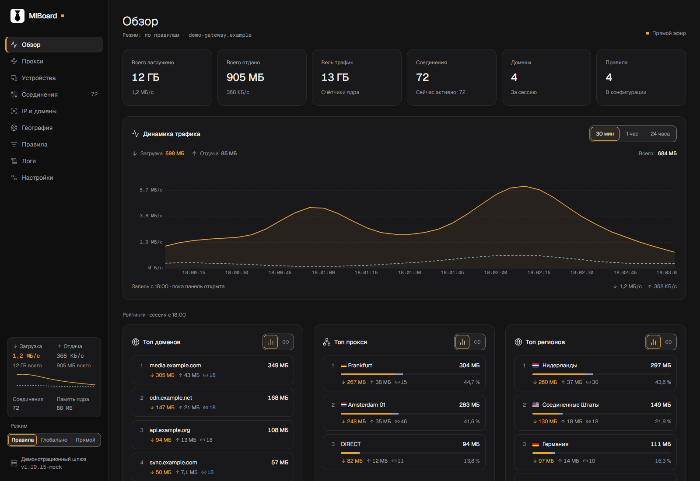
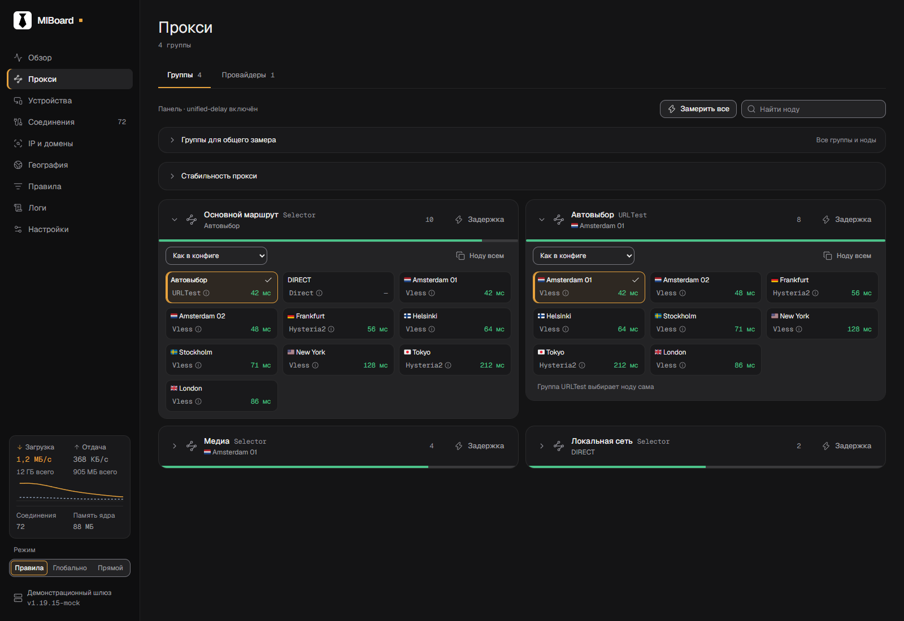
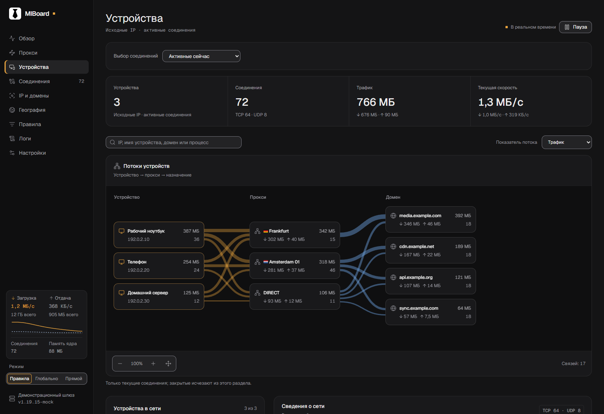
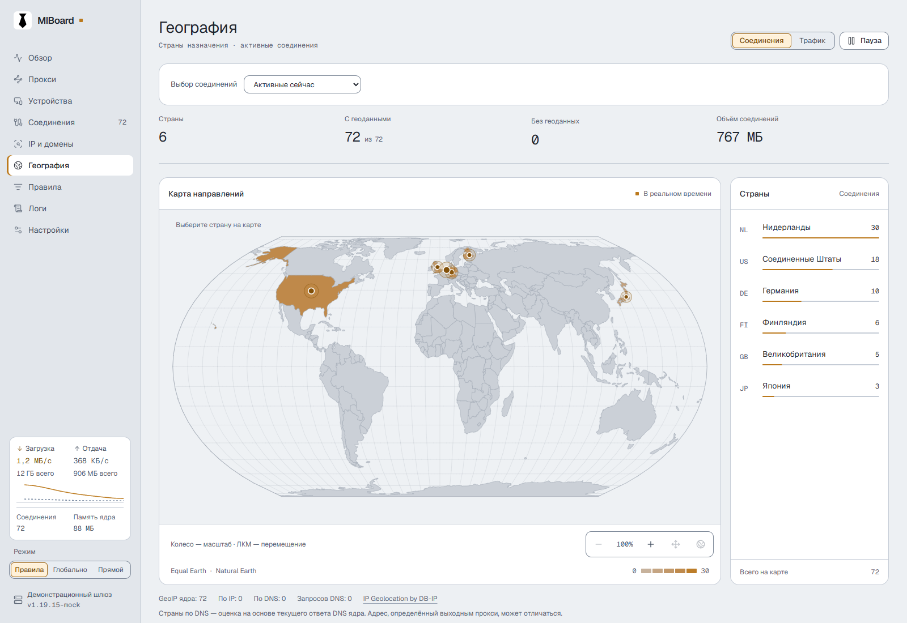

<p align="center">
  
</p>
<h1 align="center">MIBoard</h1>
<p align="center">
  <strong>Трафик, устройства и маршруты mihomo — в одной панели.</strong><br>
  Живые метрики · Диагностика соединений · Управление прокси
</p>
<p align="center">
  <strong>Русский</strong> · <a href="README.en.md">English</a>
</p>
<p align="center">
  <a href="https://github.com/blagodaren/miboard/releases/tag/v0.1.5"></a>
  <a href="https://github.com/blagodaren/miboard/releases"></a>
  <a href="LICENSE"></a>
  <a href="https://svelte.dev"></a>
  <a href="README.en.md"></a>
</p>
<p align="center">
  <a href="https://blagodaren.github.io/miboard/">Открыть панель</a> ·
  <a href="#подключение-к-mihomo">Установить</a> ·
  <a href="CHANGELOG.md">Что нового</a> ·
  <a href="https://github.com/blagodaren/miboard/issues">Сообщить о проблеме</a>
</p>

MIBoard — статическая панель для существующего ядра **mihomo**. Она работает прямо из `/ui/` ядра или на отдельном хостинге. Собственный сервер приложения и база данных не требуются.

> [!CAUTION]
> MIBoard управляет вашим экземпляром mihomo. Панель не предоставляет VPN, прокси-серверы, подписки или доступ к сети.
>
> API ядра позволяет менять маршрутизацию и настройки. Используйте надёжный `secret`, ограничьте доступ к контроллеру доверенной сетью и не публикуйте адреса с секретами. Для удалённого доступа используйте HTTPS и контролируемый доступ.

<p align="center">
  <a href="docs/images/overview-ru-dark.png"></a>
</p>

<p align="center"><sub>Скриншоты сделаны на демонстрационных данных</sub></p>

## Возможности

| Раздел | Что можно увидеть и сделать |
| --- | --- |
| **Обзор** | Загрузка и отдача, график за 30 минут / 1 час / 24 часа, рейтинги доменов, прокси и регионов |
| **Прокси** | Выбор нод, провайдеры и подписки, замеры задержки, история по URL, проверка стабильности |
| **Устройства** | Потоки «устройство → прокси → назначение», локальные названия, процессы и направления |
| **Соединения** | Настраиваемые столбцы, подробные метаданные и JSON, журнал завершённых соединений |
| **IP и домены** | Трафик по доменам, IP, приложениям, ASN и входам; DNS-диагностика и экспорт доменов в TXT |
| **География и правила** | Локальная карта стран, распределение трафика, цепочки маршрутизации и провайдеры правил |
| **Настройки** | RU / EN, светлая и тёмная темы, размеры карточек, профили серверов, перенос и синхронизация |
| **Приложение** | Установка как PWA, офлайн-оболочка, проверка обновлений, восстановление потоков и экономный режим |

> [!NOTE]
> История собирается только во время наблюдения открытой панелью. PWA не добавляет круглосуточный сбор: без связи или в экономном режиме возможны пропуски. Оболочку можно открыть без сети, но живым данным и командам нужен доступ к ядру.

[Подробности, ограничения и поведение каждого раздела →](docs/FEATURES.ru.md)

## Скриншоты

<table>
  <tr>
    <td width="50%" align="center"><strong>Прокси и группы</strong></td>
    <td width="50%" align="center"><strong>Устройства и потоки</strong></td>
  </tr>
  <tr>
    <td><a href="docs/images/proxies-ru-dark.png"></a></td>
    <td><a href="docs/images/devices-ru-dark.png"></a></td>
  </tr>
</table>

<details>
  <summary>География — светлая тема</summary>
  <p><a href="docs/images/geography-ru-light.png"></a></p>
</details>

## Скачать

| Архив 0.1.5 | Когда выбирать | Проверка |
| --- | --- | --- |
| [**dist.zip**](https://github.com/blagodaren/miboard/releases/download/v0.1.5/dist.zip) | Основной вариант: шрифты и GeoDB включены, внешний CDN не нужен | [SHA-256](https://github.com/blagodaren/miboard/releases/download/v0.1.5/dist.zip.sha256) |
| [dist-cdn-fonts.zip](https://github.com/blagodaren/miboard/releases/download/v0.1.5/dist-cdn-fonts.zip) | Меньший архив; шрифты загружаются с `unpkg.com` | [SHA-256](https://github.com/blagodaren/miboard/releases/download/v0.1.5/dist-cdn-fonts.zip.sha256) |

Функции в обоих архивах одинаковые. Если CDN недоступен, второй вариант использует системные шрифты; цветные флаги на Windows могут не отображаться.

## Подключение к mihomo

**1. Добавьте панель в конфигурацию ядра.** Пример для доступа с того же компьютера:

```yaml
external-controller: 127.0.0.1:9090
secret: "замените-на-длинный-случайный-secret"
external-ui: ui
external-ui-name: miboard
external-ui-url: "https://github.com/blagodaren/miboard/releases/download/v0.1.5/dist.zip"
```

Если ядро работает на роутере, укажите его адрес в доверенной локальной сети вместо `127.0.0.1` и ограничьте доступ межсетевым экраном. `external-ui-url` закреплён на версии 0.1.5; для последнего обычного релиза можно использовать `releases/latest/download/dist.zip`.

**2. Примените конфигурацию и откройте панель.**

```text
http://127.0.0.1:9090/ui/miboard/
```

Для роутера замените адрес на его IP. Панель предложит ввести `secret`. Профили серверов сохраняются в этом браузере.

**3. Выберите язык и оформление.** В **Settings → Appearance** доступны русский язык, тема и размер карточек. Язык интерфейса по умолчанию — английский.

<details>
  <summary>Отдельный хостинг и GitHub Pages</summary>

Откройте [готовую панель](https://blagodaren.github.io/miboard/) и разрешите её origin в mihomo:

```yaml
external-controller-cors:
  allow-origins:
    - "https://blagodaren.github.io"
  allow-private-network: true
```

GitHub Pages отдаёт только интерфейс; API остаётся на вашем устройстве. Для подключения с HTTPS-страницы используйте HTTPS API с доверенным сертификатом: CORS не устраняет ограничения mixed content. [Инструкция GitHub Pages](GITHUB_PAGES.md).

</details>

## Установка приложения и обновления

В **Настройки → Приложение и обслуживание** доступны версия, установка PWA и проверка обновлений. Для установки и офлайн-оболочки нужен HTTPS или localhost. Новая сборка применяется по кнопке; работающая панель не перезагружается внезапно.

Уведомление о релизе GitHub не заменяет файлы собственной установки. Обновите файлы UI через новый архив или настроенный `external-ui-url`, затем примените загруженную сборку в панели. [Подробности обновлений и хранения](docs/FEATURES.ru.md#установка-приложения-и-обновления).

## Документация и разработка

| Документ | Содержание |
| --- | --- |
| [Возможности и ограничения](docs/FEATURES.ru.md) | Настройки, аналитика, GeoIP, журнал, диагностика и Prizrak-Core |
| [Разработка](docs/DEVELOPMENT.ru.md) | Запуск, тесты, сборка релиза, шрифты и добавление переводов |
| [GitHub Pages](GITHUB_PAGES.md) | Хостинг, HTTPS и CORS |
| [UI Kit](UI_KIT.md) · [Changelog](CHANGELOG.md) | Правила интерфейса и история выпусков |

Для разработки нужен **Node.js 24+**; готовая панель работает без Node.js. Стек: Svelte 5, Vite, Tailwind CSS 4, Bits UI, Lucide и uPlot.

```sh
npm ci
npm run dev
```

Для локальной демонстрации выполните `npm run build`, затем `npm run mock` в другом терминале. Подключите dev-панель к `http://127.0.0.1:9090` с тестовым secret `test`.

## Лицензии и благодарности

MIBoard — [MIT](LICENSE). Лицензии зависимостей, Geist и Twemoji включены в [`public/licenses/`](public/licenses/). База DB-IP Country Lite распространяется под [CC BY 4.0](public/geodb/NOTICE.md); контуры Natural Earth — [public domain](src/lib/data/NOTICE.md).

Идеи представления трафика и оформления этой страницы вдохновлены [Neko Master](https://github.com/foru17/neko-master); поведение проверок прокси сверялось с [zashboard](https://github.com/Zephyruso/zashboard). Скриншоты показывают собственный интерфейс MIBoard.
